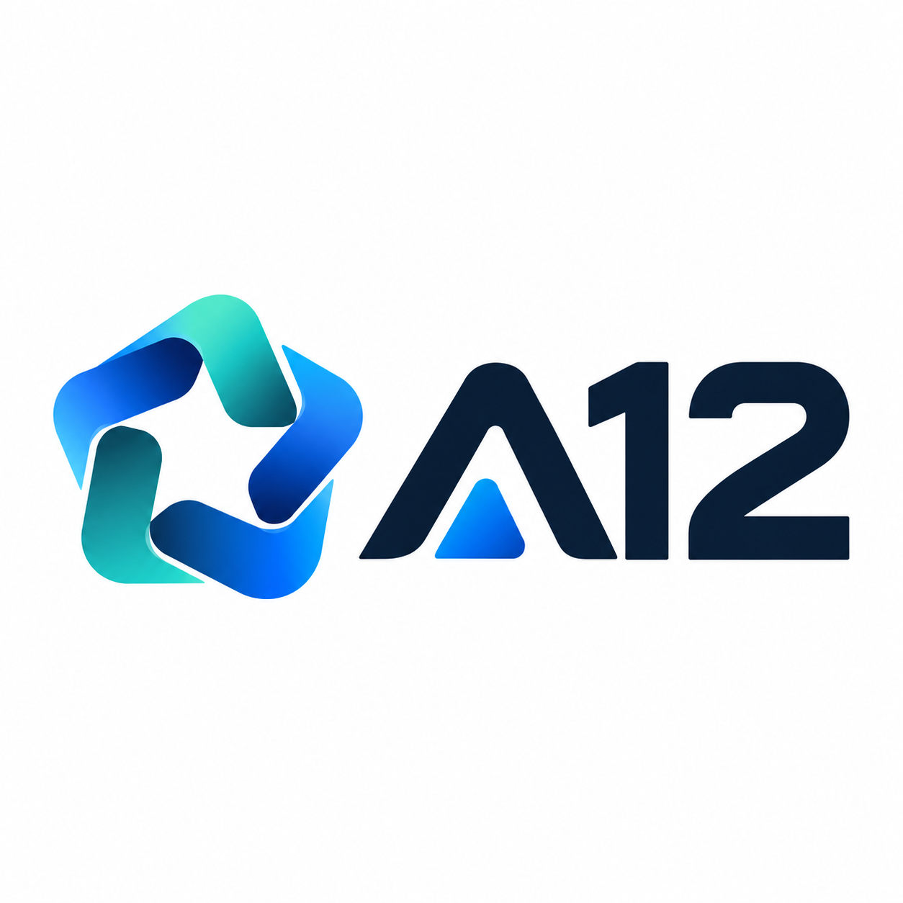

# A12 Anywear AI — Real-Time 30 FPS Virtual Try-On Platform (Web • iOS • Android • Extension)



**A12 Anywear** (`anywear.decart.ai` arxitekturasi va funksionaliga to‘liq mos) — real vaqt rejimida (30 FPS video tezligida) ishlovchi sun’iy intellekt virtual kiyib ko‘rish studiyasi, raqamli garderob hamda **Web + iOS + Android + Brauzer kengaytmasi** kross-platforma monorepo ekotizimi.

---

## Arxitektura va Monorepo Tuzilmasi

```text
webpul/
├── logo.png                          # Asosiy A12 brend logotipi
├── packages/
│   └── shared-core/                  # @webpul/shared-core (Web, iOS va Android uchun umumiy yadro)
│       └── src/index.ts              # Kiyim modellari, URL parser, 17-nuqtali poza va fizika tiplari
├── apps/
│   ├── web/                          # Next.js 16 + React 19 Jonli AI Studiya (Live Mirror)
│   │   ├── public/logo-mark.png      # Shaffof A12 logotip belgisi
│   │   └── src/
│   │       ├── app/                  # Asosiy sahifa va /api/tryon REST endpointi
│   │       ├── components/           # 30 FPS Neyron Canvas, iOS/Android Simulyator, E-Commerce SDK
│   │       └── lib/                  # UZ / EN / RU ko‘p tilli lug‘at va testlar
│   ├── mobile/                       # Android va iOS mobil ilovasi (React Native + Expo + WebRTC)
│   │   ├── app.json                  # iOS (ai.a12.anywear) va Android konfiguratsiyasi
│   │   ├── App.tsx                   # Mobil kamera, Share-Sheet URL qabul qiluvchi va Garderob
│   │   └── src/services/
│   │       └── webrtcLucyStream.ts   # 38ms WebRTC + Apple CoreML / Android NNAPI striming klienti
│   └── extension/                    # Chrome / Edge Universal Drag-and-Drop kengaytmasi
│       ├── manifest.json             # Manifest V3 konfiguratsiyasi
│       └── content-script.js         # Onlayn do‘konlardan rasmlarni to‘g‘ridan-to‘g‘ri tortib olish
```

---

## Asosiy Imkoniyatlar

1. **Jonli 30 FPS AI Virtual Kiyib Ko‘rish (`Live AI Studio`)**
   - **Jonli Veb-Kamera (`getUserMedia`)** hamda **30 FPS Interaktiv AI Podium Modeli** (`Podium Yurishi`, `360° Aylanish`, `Kursor bilan Tana Boshqaruvi`).
   - **Real-Vaqt Mato Fizikasi (`Lucy V-TON`)**: Ipak (`silk`), binoiy jun (`wool`), charm (`leather`), paxta (`cotton`) va `techwear` matolarining shamol, tana burilishi va yorug‘likka moslashuvi.
   - **Oldin / Keyin (`Split-Screen Wipe`)**: Asl tasvir va AI kiyib ko‘rish natijasini jonli vertikal lazer chizig‘i orqali solishtirish.
   - **Suratga olish (`.PNG` Lookbook)** va **Video yozib olish (`.WEBM` 30 FPS MediaRecorder)**.

2. **Universal Havola (URL) va Drag & Drop Import**
   - Istalgan onlayn do‘kon (Zara, ASOS, Farfetch, Uzum Market, Shopify) mahsulot havolasini tashlang yoki kompyuterdan/saytdan kiyim rasmini oyna ustiga tortib tashlang (`Drag & Drop`).

3. **Mobil Ilova — iOS va Android (`apps/mobile` + Interaktiv Simulyator)**
   - Veb-ilovaning ichida **iPhone 16 Pro (iOS)** va **Pixel 9 Pro (Android)** interaktiv simulyatori mavjud.
   - `a12anywear://tryon?...` Deep-Link orqali veb-sessiyani darhol smartfonda davom ettirish.

4. **Brauzer Kengaytmasi va Do‘konlar uchun 1-Qatorli SDK (`apps/extension`)**
   - Har qanday internet-do‘konga 1 qator `<script>` orqali **"Try On Live with A12"** vidjetini o‘rnatish.

---

## Ishga Tushirish

```bash
# Tekshiruv va testlar
pnpm typecheck
pnpm test

# Veb-studiyani ishga tushirish (http://localhost:3000)
pnpm dev:web

# Production build
pnpm build:web
```
